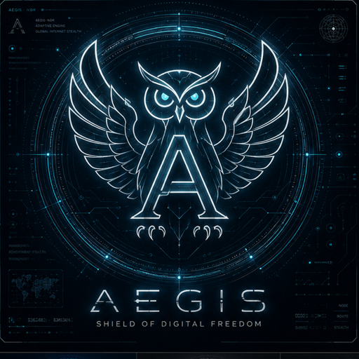

<p align="center">
  
</p>

<h1 align="center">AEGIS</h1>

AEGIS is a Rust client and relay for reaching the open internet from networks
that block or degrade ordinary connections. Applications talk to a local
client; the client carries their traffic over an authenticated, encrypted
session to a relay the operator controls, and the relay connects to the
destination. Routing on the client is fail-closed: when a required carried
path fails, traffic is refused rather than sent around the tunnel.

**Status: beta.** This is the first public import of the source. Interfaces,
configuration formats and packaging can still change, there is no stable
release, and no independent security audit covers this code yet. AEGIS is not
an anonymity system: the relay operator can see destinations and traffic
timing.

## Components

| Path | What it is |
|---|---|
| `aegis-core` | Shared protocol, framing, crypto, carrier and policy code |
| `aegis-client` | The client: local SOCKS5 and OS-level capture (Linux TUN/TPROXY, Windows Wintun/WFP, macOS utun), carrier selection, route scoring and recovery |
| `aegis-server` | The relay: carrier listeners (HTTPS/WebSocket, gRPC over HTTP/2, MASQUE over QUIC), device authorization, policy publication and forwarding |
| `aegis-quic-boring` | QUIC TLS integration on BoringSSL |
| `aegis-web-carrier`, `aegis-webrtc` | Web-response and WebRTC carriers |
| `aegis-geneva` | Geneva-style packet strategy engine (offline, plus an opt-in Linux bridge) |
| `aegis-fingerprint`, `aegis-knowledge` | TLS fingerprint audits and the embedded reference corpus |
| `aegis-android-jni` | Android JNI bindings (experimental) |
| `tools/macos/aegis-network-extension` | macOS NetworkExtension app and Packet Tunnel provider (separate Cargo package) |
| `tools/windows/aegis-winctl` | Windows service and package control |
| `tools/measure`, `tools/witness`, `tools/transport-lab` | Measurement, ClientHello comparison and transport test tools |
| `scripts/`, `packaging/` | Installers, package builders, systemd units and contract tests |
| `docs/` | Architecture, protocol, platform and operator documentation |

## Building

The toolchain is pinned in `rust-toolchain.toml` (Rust 1.97.1).

```sh
cargo build --workspace
cargo test --workspace
cargo clippy --workspace --all-targets -- -D warnings
cargo fmt --all -- --check
```

Some optional features need native libraries: the WebRTC media path links
libvpx (the CI builds a pinned libvpx with
`scripts/qa/sfu-libvpx-native-r1.py`), and the TLS/QUIC backends build
AWS-LC and BoringSSL, which need CMake, a C compiler and, on Windows, the tools
prepared by `tools/windows/prepare-build.ps1`. The exact commands each
platform runs are in [`.github/workflows/ci.yml`](.github/workflows/ci.yml).

The macOS NetworkExtension package is built separately:

```sh
cd tools/macos/aegis-network-extension
MACOSX_DEPLOYMENT_TARGET=14.4 cargo test --locked --features apple --lib
```

Signing it requires your own Apple Developer Team ID; see
[its README](tools/macos/aegis-network-extension/README.md).

Configuration examples are in `config.example.toml` (client) and
`aegis-server.toml.example` (relay). Installation and operation are described
in [INSTALL.md](INSTALL.md) and under [`docs/`](docs/README.md).

## Contributing and security

See [CONTRIBUTING.md](CONTRIBUTING.md). Please report suspected
vulnerabilities privately as described in [SECURITY.md](SECURITY.md), not in a
public issue.

## License

AEGIS is dual-licensed under the [MIT license](LICENSE-MIT) or the
[Apache License, Version 2.0](LICENSE-APACHE), at your option. See
[NOTICE](NOTICE) for attribution. Third-party components keep their own
licenses: the vendored crates under `third_party/` carry their license files,
and [THIRD-PARTY-NOTICES](THIRD-PARTY-NOTICES) lists the licenses of the
dependencies that are compiled into the binaries.
