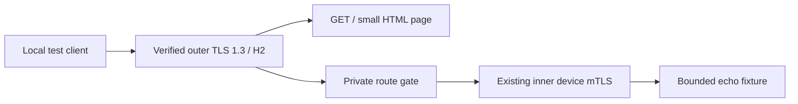

# Independent ingress laboratory

This private Rust workspace crate turns ingress research into bounded,
reproducible experiments. It is based on main
`a8ae1365a2a4c334c45c5950baaac85bb2141d22` (M9). It is not an installed
client transport, a public proxy, or evidence of beta exit. `publish = false`.

The executable runs offline synthetic scenarios and finite analysis of a
validated private dependency inventory. Network experiments are
opt-in tests against loopback. There is no fleet deployment, cloud provisioner,
native WebRTC driver, capture request, or scheduled continuation in this crate.
Its addition does not replace the verified RC31 private artifact baseline or its outstanding
signing, installed lifecycle, target-network, capture and acceptance criteria.

## What executes today

| Component | Implemented experiment | Boundary |
| --- | --- | --- |
| `https_bridge` | Real verified TLS 1.3/H2; one authority serves HTML and a privately gated gRPC carrier; existing inner device mTLS accepts an echo | Loopback, fixed small site and echo only. No Tor WebTunnel compatibility or HTTPT indistinguishability claim |
| `message_carrier` | Bounded ordered-message adapter implementing `AsyncRead + AsyncWrite`; partial I/O, backpressure and FIN handling | Tokio channels, not WebRTC/ICE/DTLS/SCTP. Existing inner mTLS is tested over it |
| `mediated_route` | Admission before any hypothetical probe; distinguishes peer ICE, TURN relay-only and an owned SFU/API path | Trust and readiness are caller attestations. No signaling, allocation, codec or service connection |
| `ephemeral_ingress` | Prepared/active/draining/retired entries; bounded pre-auth retries and request reservations; no post-auth replay | No Lambda/Vercel deployment or signature verifier. Old sessions remain on the old carrier; no TCP migration |
| `deferred_cover` | Same-length, known-body replacement becomes available on the next poll; bounded queues, sequence checks and owner-driven expiry | Huma-inspired model, no browser/web server or Balboa compatibility. Fixed framing is not natural-content steganography |
| `causal_queue` | Causal FIFO service with buffer, padding, delay and outage budgets; byte conservation and conditional network-calculus bounds | Abstract ticks and fluid bytes; no TCP ACK model, cover distribution, DP or live service guarantee |
| `nonstationary` | Deterministic lifetime versus sliding-window UCB replay with admission exclusions applied before exploration | Synthetic rewards, not production Brain or a regret/delivery guarantee |
| `dependency_cuts` / `fleet_inventory` | Finite Boolean route/dependency graph and a bounded private JSON CLI consumer | Operator declarations, explicit unknowns and finite cuts; no inferred independence, observed probabilities or scale-free model |
| `full_flow` | Held-out toy counterexample using three order features: equal size/gap/direction histograms can conceal sequence differences | Small synthetic dataset; no measured Aegis detection rate or trained deployment classifier |

The HTTPS fixture preserves two separate trust layers:



An unauthenticated route receives a fixed generic 404 before a carrier is
created. The site is deliberately small; this is a protocol/authentication
fixture, not proof that active probes cannot distinguish a deployed site.
Outer TLS validates its hostname/CA. Inner TLS validates the relay and allowed
device and retains the existing revocation lease. The outer service never
substitutes for inner authentication or payload encryption.

Every HTTPS listener accepts loopback only, uses 3–10-second total bounds and
finite connection/request/echo caps, and joins or cancels its owned tasks.
Failed H2 connections are counted as failures. When connection failure or
cancellation, or a cancelled/panicked request task, discards partial counters,
`counts_may_be_incomplete` is true;
zero counters then cannot establish absence of activity. TLS key logging is
disabled. Credential files in Unix fixtures are disposable and mode 0600.

The in-memory secure-carrier tests use the actual core `Client::connect` and
`Server::accept`, a one-message queue, an authenticated open, a 25,085-byte
payload and TLS half-close. They also reject another device signed by the same
CA and a silent peer. These custody/TLS fixtures are currently Unix-only;
portable model and adapter tests are separate. None is an independent capture.

## Reproduce

From the repository root:

```sh
cargo run --offline -p aegis-transport-lab -- --help
cargo test --offline -p aegis-transport-lab -- --test-threads=1
cargo clippy --offline -p aegis-transport-lab --all-targets -- -D warnings
```

The executable registers the six named model actions and `--build-info`/help
entrypoints. The old synthetic `demo` aggregation is intentionally omitted from
the CLI; its queue, rotation, cover, route, cut and flow models remain library
APIs with their original unit tests. Missing or undeclared actions refuse before
model dispatch. This is a command surface boundary, not a sandbox or a claim
that producer metadata alone establishes reachability.

The CLI contains no listener command. Library values are not measured production
performance. The full test command needs permission to bind a local TCP socket
for the existing HTTPS fixtures.

## Private dependency inventory

`dependencies <private-inventory.json>` consumes operator-declared fleet
dependencies without contacting an endpoint or changing the fleet. Use opaque
numeric IDs and maintain their private mapping separately. Neither different
IPs nor different IDs establish independence. Output includes only numeric
IDs, counts, declared unknown/not-required categories, finite cuts and the
SHA-256 of the exact input bytes; the report is still private topology metadata.
All measurement, verified-independence and beta-exit fields remain false.

The versioned schema rejects extra fields, duplicate fields/IDs/references,
unknown references, wrong dependency kinds, missing category declarations and
unused nodes. Every route declares `provider`, `dns` and `bootstrap` explicitly:

- `known`: a nonempty `dependency_ids` list declares the category complete.
- `unknown`: zero or more known IDs plus unresolved dependencies. The category's
  cuts and combined cuts are `null` with `unresolved_dependencies`; no dummy
  provider is inserted. Complete other categories may still be calculated with
  all unselected dependencies assumed available.
- `not_required`: an empty list explicitly declares that DNS or bootstrap is
  unnecessary in the modeled operation. Providers cannot be `not_required`.
  This assumption is retained in the report, not verified by the tool. Include
  bootstrap and resolution dependencies even if the relay address is cached
  when they are required for the operation being modeled.

`provider` references only `provider` nodes, `dns` only `dns`, and `bootstrap`
references `controller`, `broker` and/or `sfu` nodes. Here is a **synthetic**
inventory with distinct declared providers and a shared DNS/controller:

```json
{
  "artifact_schema": "aegis_fleet_dependency_inventory_v1",
  "dependencies": [
    {"id": 1, "kind": "provider"},
    {"id": 2, "kind": "provider"},
    {"id": 3, "kind": "dns"},
    {"id": 4, "kind": "controller"}
  ],
  "routes": [
    {"id": 1,
     "provider": {"status": "known", "dependency_ids": [1]},
     "dns": {"status": "known", "dependency_ids": [3]},
     "bootstrap": {"status": "known", "dependency_ids": [4]}},
    {"id": 2,
     "provider": {"status": "known", "dependency_ids": [2]},
     "dns": {"status": "known", "dependency_ids": [3]},
     "bootstrap": {"status": "known", "dependency_ids": [4]}}
  ]
}
```

Save an inventory in a trusted directory with owner-only file access, for
example mode 0600 on Unix. The CLI reuses the core private-file reader and
trusted-ancestry check; final symlinks and special files are refused. OS/parser
errors do not echo the path or inventory. Redirect reports with private access:

```sh
umask 077
cargo run --offline -p aegis-transport-lab -- dependencies /private/path/inventory.json > /private/path/cuts.json
```

Input is capped at 65,536 bytes, 16 declared dependency nodes, 16 alternative
routes and 16 references per route. IDs are integers 1–255. Each of the four
families (provider, DNS, bootstrap, all) selects at most eight known nodes and
enumerates at most 255 nonempty subsets. Larger complete families report
`cut_budget_exceeded` and `null` cuts; other families remain usable. `[]` means
there is no outage cut in a **complete declared** family, whereas `null` means
the family was not analyzed. Unknown-only inventories with no known nodes are
accepted and never promoted to complete graphs.

Alternatives are OR and dependencies within a route are AND. The synthetic
example produces provider cut `[1, 2]`, DNS cut `[3]`, bootstrap cut `[4]` and
combined cuts `[3]`, `[4]`, `[1, 2]`. These are deterministic inclusion-minimal
outage sets under the supplied assumptions. The tool does not discover hidden
dependencies, model probabilities, prove a Nature percolation/cascade theorem,
or certify fleet resilience. It makes no production route decision.

The model/parser tests are portable. Private CLI custody regressions currently
run on Unix, using only disposable synthetic files:

```sh
cargo test --offline -p aegis-transport-lab --lib fleet_inventory
cargo test --offline -p aegis-transport-lab --test fleet_inventory_cli
```

`tests/source_regressions.rs` also includes the actual product shaping and
traffic-score source files. Native `aegis-client` and `aegis-measure` tests and
exact-commit workspace CI remain required; this harness does not replace them.

## Mathematical model commands

These Rust callers execute the implemented algorithms on explicitly supplied
finite models. Inputs are capped at 1 MiB before parsing; dimensions, codebooks,
queues, iterations and aggregate enumeration have additional bounds.

```text
aegis-transport-lab bittraps-channel <finite-stream-grid.json>
aegis-transport-lab privacy-channel <finite-channel.json>
aegis-transport-lab topology <paired-graphs.json>
aegis-transport-lab awgn <awgn-model.json>
aegis-transport-lab poisson-channel <queue-channel.json>
```

`bittraps-channel` evaluates whole finite Markov arrival/output sequences,
observable overflow and a declared service grid. `privacy-channel` solves a
label-blind cost-constrained channel or a separate finite label-conditioned
Wasserstein model. The latter also has an explicit-context opt-in
[Liu stream consumer](../../docs/research/liu-runtime-channel.md); this offline
command does not activate that consumer. `topology` evaluates finite attacks and coupled cascades;
provided observed graphs remain unauthenticated inputs. AWGN and Poisson commands
run actual finite coding/decoding/detection and causal queue algorithms, including
explicit failed-prefix and planned/actual distinctions.

These commands open no sockets and do not create acceptance evidence. A physical
AWGN channel is not an IP flow; finite floating models are not mathematical
interval certificates, calibrated cover or field guarantees. The
[eleven-work matrix](../../docs/research/implementation-and-composition.md)
links the implemented algorithms, real runtime consumers and their assumptions.

## Research translated into testable assumptions

| Primary source | Useful question here | What the laboratory does not establish |
| --- | --- | --- |
| [HTTPT](https://www.usenix.org/system/files/foci20-paper-frolov.pdf), [WebTunnel](https://community.torproject.org/relay/setup/webtunnel/) | Can a reachable HTTPS service preserve its ordinary site while admitting an authorized carrier? | Reachability through a strict IP allowlist; complete camouflage against active probes; Tor protocol compatibility |
| [Snowflake](https://www.usenix.org/system/files/usenixsecurity24-bocovich.pdf) | How do temporary entries, independent discovery and bounded failures compose? | A native proxy/broker implementation or an unblocked pool |
| [Protozoa](https://web.ist.utl.pt/diogo.barradas/papers/barradas-ccs20.pdf) | Does payload physically traverse a reachable service rather than direct peer ICE? | An authorized third-party call, media steganography or resilience to service degradation |
| [Huma](https://www.ndss-symposium.org/wp-content/uploads/2026-f328-paper.pdf), [Balboa](https://www.usenix.org/system/files/sec21-rosen.pdf) | Can delayed web responses carry already encrypted data with finite queues? | Natural web-content distribution, opaque timing, TLS 1.3 Balboa interoperability or an implemented browser carrier |
| [CensorLess](https://arxiv.org/abs/2603.00345) | How do admission rotation, drain deadlines, bootstrap dependencies and resource reservations behave? | Universal cost savings, blocking impossibility, safe committed-session migration or actual cloud billing enforcement |
| [BIT-TRAPS](https://www.winlab.rutgers.edu/~suhas/BITTRAP_TIFS_2col.pdf), [NetShaper](https://www.usenix.org/system/files/usenixsecurity24-sabzi.pdf), [rate–distortion preprint](https://arxiv.org/abs/2607.17889) | Which padding/delay budgets and leakage measurements deserve comparison? | Finite full-sequence/grid and cost-constrained channel implementations are callable below; no stationary global optimum or whole-network DP certificate. The label-conditioned optimizer has a causal Liu runtime consumer; operator classes, calibration and whole-flow acceptance remain separate |
| [Minimum entropy coupling](https://arxiv.org/abs/2210.14889) | Could a small control channel preserve an explicitly known cover distribution? | General greedy/iMEC is implemented in the Rust core and consumed by keyed control/stream adapters; it does not establish perfect camouflage of the outer TLS flow |
| [Network calculus](https://leboudec.github.io/netcal/) | Under a validated arrival envelope and guaranteed configured service, what bounds the queue and delay? | Those service guarantees on the Internet or during configured outages |
| [Nonstationary bandits](https://arxiv.org/abs/0805.3415) | Does limited history adapt differently after an imposed regime change? | A theorem for production Brain or a measured optimal switching policy |
| [Albert et al.](https://www.nature.com/articles/35019019), [Buldyrev et al.](https://www.nature.com/articles/nature08932) | Which shared dependencies can remove several apparent alternatives together? | A justified probabilistic/cascade threshold for the actual fleet |

Encryption and shaping cannot create reachability to a blocked address. An
owned HTTPS entry removes dependence on Cloudflare only where that entry is
reachable. A service-mediated route needs a reachable, authorized service and
an actual forwarding path. Direct P2P WebRTC alone does not meet that condition.

The next production adapter must integrate carrier selection into the existing
secure installed-client path, verify descriptors cryptographically before
probing, and preserve device authorization, revocation, bounded cleanup and
the no-replay boundary. Native ICE/SCTP or SFU/media forwarding, bootstrap
delivery and real web-cover distributions require separate implementations and
measurements. A live evaluation then needs the exact candidate, ready guests,
bounded intervals, independent rollback and authorized independent captures.
No success in this laboratory closes those acceptance requirements.

## Local source and maintenance guide

A private publish=false Rust laboratory for bounded transport models, dependency inventory and explicitly controlled carrier experiments.

### Contracts and limits

Offline topology/AWGN/Poisson/privacy/Markov calculations are model results; owned localhost TLS/H2 experiments check only their declared carrier scope. Neither class is a target-network, WebRTC/SFU/serverless deployment or whole-flow privacy acceptance.

### Entry points and maintenance

Keep the existing detailed guide below. src/main.rs is the CLI, src/lib.rs exposes model/fixture modules and research-build-info is available through --build-info.

Use a built executable to inspect the command surface or build identity:

```text
aegis-transport-lab --help
aegis-transport-lab --build-info
```

### Local map

- [Cargo.toml](Cargo.toml)
- [build.rs](build.rs)
- [src/](src/README.md)
- [tests/](tests/README.md)

### Workspace build

From the repository root, with the locked dependencies and the required target toolchain available:

```bash
cargo build --locked -p aegis-transport-lab
```
